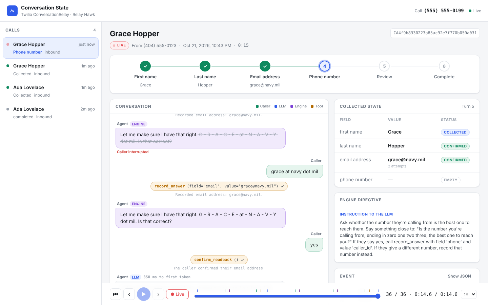
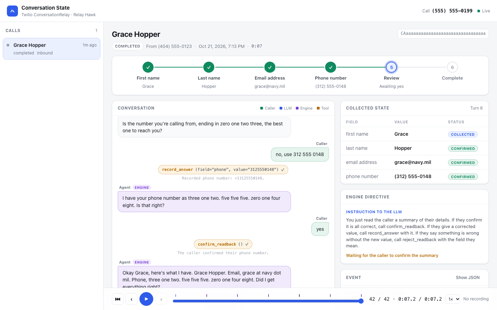

# Twilio ConversationRelay: Conversation State

A voice agent on [Twilio ConversationRelay](https://www.twilio.com/docs/voice/conversationrelay) that collects a caller's **first name, last name, email address, and phone number**. A deterministic state engine owns the call. A dashboard shows that state **live while the call happens** and lets you **replay any finished call step by step**, synced to the call recording.

It builds on [`twilio-conversation-relay`](../twilio-conversation-relay). That sample shows the raw ConversationRelay protocol. This one adds the part every real voice bot needs: knowing what it has collected, what it still needs, and proving afterwards how it got there.



## What it shows

- **The engine owns the call, not the LLM.** Question order, readbacks, confirmation, and "are we done?" are plain Python ([`src/flow.py`](src/flow.py)). The LLM only interprets what the caller said, through three tools: `record_answer`, `confirm_readback`, and `reject_readback`.
- **Lines that must be exact are never paraphrased.** Spelled-out readbacks, the summary, and the goodbye come from the engine, word for word. The dashboard tags every agent line as `LLM`, `Engine`, or `Greeting`.
- **Readbacks are typed.** The engine knows whether a value is a name, an email, or a phone number, so it writes each one the way TTS engines read clearly, not however the LLM happens to type it. See [Readback formatting](#readback-formatting).
- **Values are validated when they're captured.** An email has to parse. A phone number has to be a real, dialable number, normalized to E.164 with `phonenumbers`. "555-1234" is rejected and the bot asks again for the area code.
- **Caller ID is offered.** If the caller's number is valid, the bot asks "Is the number you're calling from, ending in zero one four eight, the best one to reach you?" A "yes" fills the field with no second readback.
- **Callers can go out of order.** "Hi, I'm Grace Hopper" fills both name fields, and the bot never asks again for something it already has. Saying "no" to a readback clears the field and asks the caller to spell it. Fixing a detail from the final summary jumps back to that field.
- **Interruptions are honest.** When the caller talks over the agent, the history keeps only what they actually heard (`utteranceUntilInterrupt`), and the dashboard strikes through the part that never played.
- **Everything is an event.** Transcript lines, tool calls with their results, LLM timing, state snapshots, and Twilio callbacks are all appended to one timeline per call. The live view and the replay view render the same timeline, so a replay shows exactly what was on screen live.



## How it fits together

```
 Caller ──► Twilio number
              │ 1. POST /twiml  ──────────────►┐
              │ 2. WebSocket /ws (ConversationRelay: setup / prompt / interrupt)
              ▼                                │
   ┌───────────────────── FastAPI (this app) ──┴─────────────────────┐
   │  CallSession (src/agent.py)                                     │
   │    caller text ─► LLM + CURRENT DIRECTIVE ─► tool calls         │
   │                        │                        │               │
   │                        ▼                        ▼               │
   │              streamed reply text      CallFlow (src/flow.py)    │
   │                                        state + next directive   │
   │                                                 │               │
   │  Recorder ─► SQLite events (src/store.py) ─► LiveHub ─► /ui/ws ─┼──► Dashboard
   └─────────────────────────────────────────────────────────────────┘
              ▲  /twilio/status, /twilio/recording, /twiml/connect-action
```

Each caller turn:

1. ConversationRelay sends the transcribed words as a `prompt`.
2. The LLM gets the conversation plus a final system message with the **current state and directive** (for example, "Ask for the last name"). That message is rebuilt every turn and never stored in history, so the model never acts on a stale directive.
3. If the model replies with text, it streams straight to Twilio. If it calls tools, the engine applies them, then either speaks its own exact line (a readback, the summary, the goodbye) or runs a second, tool-free LLM pass against the new directive.
4. Once everything is confirmed, the engine says goodbye and sends `{"type": "end", "handoffData": ...}` with the collected values. Twilio then calls `/twiml/connect-action`, which hangs up.

### Why FastAPI and not Twilio Functions?

ConversationRelay needs **your** WebSocket server to connect to, and it holds that connection open for the whole call. Twilio Functions are short request/response handlers (10-second limit, no inbound WebSocket support, no memory between invocations), so they can't host the session that holds the call's state. You could serve the `/twiml` webhook from a Function, but the WebSocket, and so the state, has to live in a long-running server. Here that's one small FastAPI app.

## Quick start

You need Docker, an [ngrok](https://dashboard.ngrok.com/signup) account with a static domain, an OpenAI API key, and a Twilio account with a voice-capable number.

```bash
cd twilio-conversation-state
cp .env.example .env        # fill in PUBLIC_URL, NGROK_AUTHTOKEN, OPENAI_API_KEY, TWILIO_*, DASHBOARD_PASSWORD
docker compose up --build
```

Point your number at the app (run it again whenever your ngrok URL changes):

```bash
docker compose exec api python -m scripts.configure_number          # uses TWILIO_PHONE_NUMBER
docker compose exec api python -m scripts.configure_number --list   # see the account's numbers
```

Open `https://<PUBLIC_URL>/` and call the number. The call appears and opens the moment it connects. With `DASHBOARD_PASSWORD` set, the header also shows a **Call me** box that has the agent dial you, which is handy in a meeting.

### No phone? Type instead

`scripts/simulate_call.py` pretends to be Twilio. It fetches TwiML, opens the ConversationRelay socket, and sends your lines as `prompt` messages. Everything except speech runs for real: OpenAI, the engine, storage, and the dashboard.

```bash
docker compose exec api python -m scripts.simulate_call
docker compose exec api python -m scripts.simulate_call --say "Hi, I'm Ada" --say "Lovelace" --say "yes" \
  --say "ada at analytical engine dot com" --say "yes" --say "that's right"
```

### Without Docker

```bash
python -m venv .venv && . .venv/bin/activate
pip install -r requirements-dev.txt
uvicorn src.main:create_app --factory --reload --port 8000
ngrok http --url=$PUBLIC_URL 8000    # in another terminal
```

## The dashboard

| Area | What it shows |
| --- | --- |
| Call list | Live calls (pulsing) and history, named by the collected first and last name. |
| Step rail | First name → Last name → Email → Phone → Review → Complete. Done steps are checked, the current step pulses, and a `×2` badge marks a step the call came back to. |
| Conversation | Caller and agent lines with their source (`LLM`, `Engine`, `Greeting`), time to first token, tool calls with arguments and results, and interruptions. |
| Collected state | Each field's value, its status (`empty` / `collected` / `confirmed`, or `awaiting yes` while a readback is pending), and its attempts and rejections. |
| Engine directive | What the engine told the LLM at that moment, or the exact line it spoke itself. |
| Event | The selected event, with its raw JSON one click away. |
| Timeline | Every event, spaced by real time. Use **‹ ›** or the **← →** keys to step, **Space** to play, **Home/End** to jump. Live calls have a **● Live** button to re-follow the newest event. |

Replay uses the call recording when one exists. Playback moves the timeline with the audio, and clicking any line or dragging the timeline seeks the audio there. Recordings are dual-channel (caller and agent on separate channels), started through the REST API when the session connects. They are cached under `data/recordings/` so replays keep working even if you delete the recording in Twilio.

## Storage

Two SQLite tables in `data/calls.db` ([`src/store.py`](src/store.py)):

- `calls`: one row per call (numbers, direction, status, duration, recording SID and its offset into the timeline, and the final state snapshot).
- `events`: the append-only timeline (`call_sid`, `seq`, `ts`, `t_ms` since call start, `kind`, `data` JSON).

| Event kind | Written when |
| --- | --- |
| `call.started` | `/twiml` is hit |
| `session.setup` | ConversationRelay connects |
| `transcript` | a caller or agent line (`source`: `llm`, `engine`, `greeting`) |
| `llm` | each model pass: directive, `tool_choice`, first-token and total latency, tool calls |
| `tool` | a tool ran: name, arguments, `ok`, and the message returned to the model |
| `snapshot` | full engine state after setup, after tools, and after the engine speaks |
| `interrupt` | the caller talked over the agent: what they heard |
| `session.end` / `session.ended` | the engine ended the session / Twilio's connect action fired |
| `recording.started` / `recording` | the recording started / its status callback arrived |
| `twilio.status` | call status callbacks |
| `turn.cancelled`, `error`, `dtmf`, `socket.closed` | as named |

`GET /api/calls/{call_sid}` returns the call and its full timeline, which is the same data the dashboard replays. To send results somewhere else, read `final_state` or the `session.end` handoff data. Swapping SQLite for Postgres or DynamoDB only touches `store.py`.

## Readback formatting

Engine-owned lines go through [`src/speech.py`](src/speech.py), which follows the same rules as the text normalizer in Relay Hawk's production voice agents. The rules come from our TTS readback evaluation: about 4,500 synthesized clips across ElevenLabs, Rime, OpenAI, and Cartesia, each transcribed back by two STT engines and scored for accuracy, artifacts, and pacing.

| Value | Spoken as | Why |
| --- | --- | --- |
| Last name `Hopper` | `H - O - P - P - E - R` | Capital letters are read as letter names. A plain space runs the letters together, a period makes ElevenLabs Flash rush them like initials, and a comma is an optional pause Flash skips when it speaks fast. A spaced dash gave a clear pause between every letter. |
| Email `brandon650@gmail.com` | `B - R - A - N - D - O - N - six - five - zero - at - gmail dot com` | `@` becomes ` - at - ` so there's a pause on both sides. Digits become words. Well-known providers are spoken as words, because the caller already knows how "gmail" sounds. |
| Email `grace@relayhawk.com` | `G - R - A - C - E - at - R - E - L - A - Y - H - A - W - K dot com` | Unknown domains are spelled so the caller can catch "relayhawk" being heard as "reallyhawk". The TLD stays a word. |
| Phone `+13125550148` | `three one two. five five five. zero one four eight` | Flash reads bare digits as one cardinal number ("four billion…"), so digits become words. Groups are 3-3-4 and joined with a **period**: across 10 runs, a period kept both group pauses 10 out of 10 times, a comma only 3. |
| Summary | `Grace Hopper. Email, grace at relayhawk dot com. Phone, three one two. …` | Each value was already spelled and confirmed, so the summary uses natural forms. |

Spelled-out words read correctly on every TTS provider ConversationRelay supports, so there is no per-provider branching. Rime's `spell()` syntax isn't needed here. These rules were measured on a streaming TTS pipeline outside ConversationRelay. Re-check them by ear on a ConversationRelay call if you change the voice or model; the evaluation found that ElevenLabs `multilingual_v2` spells more slowly and clearly than the `flash_v2_5` voice this template defaults to.

Only engine-owned lines are formatted. If the LLM speaks an email or number in free text, for example while answering an off-topic question, it goes to TTS unformatted. Covering that case takes a streaming transform over LLM output, which would be the next step if it matters.

## Changing what gets collected

Fields are data. Add a `FieldSpec` to `FIELDS` in [`src/flow.py`](src/flow.py):

```python
FieldSpec(
    key="account_number",
    label="account number",
    question="And what's your account number?",
    normalize=normalize_account_number,  # raise ValueError to reject at capture time
    readback=lambda v: f"That's {spell_chars(v)}. Is that right?",  # omit to skip confirmation
),
```

The step rail, the state table, the tool enum the LLM sees, and the stored snapshots all pick it up automatically. Update `summary_line()` if the new field should be read back at the end.

## Security

- **Twilio webhooks** are checked against `X-Twilio-Signature` whenever `TWILIO_AUTH_TOKEN` is set. The check uses `PUBLIC_URL`, so that value must match the URL configured in Twilio.
- **The ConversationRelay socket** only accepts sessions carrying a per-call HMAC token. `/twiml` puts the token in a `<Parameter>`, and the server checks it on `setup`. A random client can't open a session on your OpenAI bill.
- **The dashboard shows caller PII on a public URL.** Set `DASHBOARD_PASSWORD` (HTTP Basic auth, any username). Outbound calls are disabled unless it is set.

## Scaling

The live session and engine state sit in the memory of the process that holds the WebSocket. That is correct for ConversationRelay, because the socket is pinned to one process for the whole call. Run more instances behind a load balancer and each handles its own calls. Two things would need to move out of process: the dashboard fan-out (`LiveHub`, for example to Redis pub/sub) and storage (from SQLite to a shared database).

## Tests

```bash
pip install -r requirements-dev.txt
pytest
```

`tests/test_flow.py` covers the engine: ordering, out-of-order answers, readback guards, corrections, summary fixes, phone validation, and caller ID. `tests/test_speech.py` pins the exact readback strings. `tests/test_call.py` speaks the ConversationRelay protocol into `/ws` with a scripted LLM. It runs a full call through to `end` and checks the stored timeline, interrupt trimming, token and signature rejection, and dashboard auth.

## Configuration

| Variable | Default | |
| --- | --- | --- |
| `PUBLIC_URL` | `localhost:8000` | Public host Twilio reaches (`NGROK_URL` also accepted) |
| `OPENAI_API_KEY` / `OPENAI_MODEL` | – / `gpt-4.1-mini` | |
| `TWILIO_ACCOUNT_SID` / `TWILIO_AUTH_TOKEN` | – | Signatures, recording, outbound calls |
| `TWILIO_PHONE_NUMBER` | – | Shown in the dashboard; caller ID for outbound calls |
| `COMPANY_NAME` | `Relay Hawk` | Used in the greeting and prompt |
| `TTS_PROVIDER` / `TTS_VOICE` | an ElevenLabs Flash voice | |
| `ENABLE_RECORDING` | `true` | Dual-channel recording for replay |
| `DEFAULT_PHONE_REGION` | `US` | Region for numbers said without a country code; numbers in its calling code are read back without one |
| `VALIDATE_TWILIO_SIGNATURES` | on when an auth token is set | |
| `DASHBOARD_PASSWORD` | – | Protects the dashboard and enables **Call me** |
| `DATABASE_PATH` / `RECORDINGS_DIR` | `data/calls.db` / `data/recordings` | |

## Project layout

```
src/
  main.py         FastAPI app: Twilio webhooks, /ws, dashboard API, /ui/ws
  agent.py        CallSession: one per call, runs the LLM turn loop
  flow.py         the state engine (pure Python, no I/O)
  speech.py       TTS-friendly readbacks + phone validation
  llm.py          streaming OpenAI wrapper (swappable for tests)
  store.py        SQLite calls + event timeline
  hub.py          Recorder (store + broadcast) and LiveHub
  twilio_api.py   recording, outbound calls, signature checks
  config.py       settings from .env
  static/         dashboard (vanilla HTML/CSS/JS, no build step)
scripts/
  simulate_call.py     text-mode ConversationRelay client
  configure_number.py  point a Twilio number at this app
tests/
```
